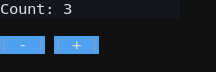
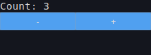
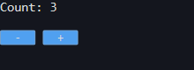
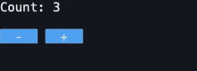

# quadraui

**A cross-platform UI framework for Rust, Python and Node.js that also runs in a terminal.**

Write an app once. It runs in a terminal (over SSH too) and as a native
window on macOS, Linux (GTK4) and Windows, drawn by quadraui's own renderers
for each.

| Terminal | GTK4 (Linux) | Windows | macOS |
|:---:|:---:|:---:|:---:|
|  |  |  |  |

*The counter below, as each backend paints it. These are real renders, made
by `scripts/capture_hero.sh` through each backend's headless test driver.*

If you know **Elm, iced, Textual or React**, you know the shape already:
**state**, a **view** that turns state into a widget tree each frame, and
**update** code that changes state when an event arrives. There is no data
binding and no manual redraw. Here is the same counter in each language.
Python and Node build the view from `Column` and `Row`; Rust, for now,
implements a lower-level trait and places each widget itself (third
below):

**Python**

<!-- sample: examples/hero/python/counter.py -->
```python
from quadraui.app import App, Button, Column, Row, TextDisplay, key_name


def text(s):
    return [{"spans": [{"text": s, "fg": None, "bg": None}]}]


class Counter:
    def __init__(self):
        self.count = 0

    def view(self):
        return Column(
            TextDisplay(text(f"Count: {self.count}"), id="count"),
            Row(Button("-", id="dec", on_click=self.dec), Button("+", id="inc", on_click=self.inc)),
        )

    def inc(self):
        self.count += 1

    def dec(self):
        self.count -= 1

    def on_key(self, event):
        if key_name(event) == "q":
            raise SystemExit


if __name__ == "__main__":
    counter = Counter()
    App(30, 5, view=counter.view, on_event=counter.on_key).run_tui()  # or .run_native(title="Counter"): same Counter
```

**TypeScript (JSX)**

<!-- sample: examples/hero/node/counter.tsx -->
```tsx
const { App, keyName } = require("@quadraui/node/app");

class Counter {
  count = 0;

  view() {
    return (
      <column>
        <textDisplay id="count" lines={[{ spans: [{ text: `Count: ${this.count}`, fg: null, bg: null }] }]} />
        <row>
          <button id="dec" label="-" onClick={() => this.count--} />
          <button id="inc" label="+" onClick={() => this.count++} />
        </row>
      </column>
    );
  }

  onKey(event: unknown, quit: () => void) {
    if (keyName(event) === "q") quit();
  }
}

if (require.main === module) {
  const counter = new Counter();
  const app = new App(30, 5, { view: () => counter.view(), onEvent: (e: unknown) => counter.onKey(e, quit) });
  const live = app.runTui(); // or app.runNative("Counter"): same Counter
  // No App.quit() yet: a key handler calls quit(), which stops the loop and the session once it returns.
  const quit = () => setImmediate(() => (live.stop(), app.stopLive()));
}
module.exports = { Counter };
```

**Rust**: the same three parts on the lower-level `AppLogic` trait. Rust has
no declarative `Column`/`Row` yet, so this view places widgets by hand.

<!-- sample: examples/hero/rust/src/main.rs -->
```rust
use quadraui::prelude::*;
use quadraui::{primitive::DynWidget, Button, FrameTree, StyledSpan};
use std::cell::Cell;

#[derive(Default)]
pub struct Counter {
    pub count: i32,
    cell: Cell<(f32, f32)>,
}

impl Counter {
    fn view(&self) -> ScreenLayout {
        let (w, h) = self.cell.get(); // one character cell, in this backend's units
        let text = StyledSpan::plain(format!("Count: {}", self.count));
        let mut label = TextDisplay::new(WidgetId::new("count"));
        label.lines = vec![TextDisplayLine {
            spans: vec![text],
            decoration: Default::default(),
            timestamp: None,
        }];
        let mut ui = ScreenLayout::new();
        let mut put = |col: f32, row: f32, cols: f32, widget: Box<dyn DynWidget>| {
            let rect = Rect::new(col * w, row * h, cols * w, h);
            ui.push(Surface::Widget { rect, widget })
        };
        put(0.0, 0.0, 20.0, Box::new(label));
        put(0.0, 2.0, 5.0, Box::new(Button::new("dec".into(), "-")));
        put(6.0, 2.0, 5.0, Box::new(Button::new("inc".into(), "+")));
        ui
    }
}

impl AppLogic for Counter {
    type AreaId = ();
    fn render(&self, backend: &mut dyn Backend, _: ()) {
        self.cell.set((backend.char_width(), backend.line_height()));
        self.view().draw(backend);
    }
    fn frame_tree(&self, _: ()) -> FrameTree {
        self.view().into_frame_tree()
    }
    fn handle(&mut self, event: UiEvent, _: &mut dyn Backend) -> Reaction {
        match event {
            UiEvent::ButtonActivated { widget } if widget.as_str() == "inc" => self.count += 1,
            UiEvent::ButtonActivated { widget } if widget.as_str() == "dec" => self.count -= 1,
            UiEvent::KeyPressed {
                key: Key::Char('q'),
                ..
            } => return Reaction::Exit,
            _ => return Reaction::Continue,
        }
        Reaction::Redraw
    }
}

fn main() -> Result<(), quadraui::RunError> {
    quadraui::tui::run(Counter::default()) // or gtk::run, macos::run, win::run: same Counter
}
```

All three are run headless in CI with the same clicks (`examples/hero/`).

```sh
cargo add quadraui --features tui   # add gtk, macos or win for a native window
pip install quadraui
npm install @quadraui/node
```

📖 **[Docs and quick starts](https://jdonaghy.github.io/quadraui)**
([Rust](https://jdonaghy.github.io/quadraui/quick-start/rust.html) ·
[Python](https://jdonaghy.github.io/quadraui/quick-start/python.html) ·
[Node](https://jdonaghy.github.io/quadraui/quick-start/node.html)) ·
[Widget gallery](https://jdonaghy.github.io/quadraui/gallery/index.html) ·
[API reference](https://docs.rs/quadraui) ·
[Examples](examples/hero/) ·
[Changelog](CHANGELOG.md)

## Why it is different

- **Terminal and native from one codebase.** Ratatui and Textual have no
  native backend; egui, iced and Slint have no terminal backend. quadraui
  has both, behind one trait.
- **One implementation per widget.** A widget is one Rust type that
  implements two traits: `Primitive` (lay out and paint) and
  `Interactive` (focus, input, popups). The same code paints on all four
  backends; a backend supplies drawing verbs and platform services and
  holds no per-widget code.
- **Paint and click share one layout.** A widget's `layout(...)` result
  is what it paints from and what its event handler hit-tests against.
  Mouse clicks cannot drift from what is on screen, because both read the
  same computed rectangles.
- **Small, and idle when idle.** A macOS release binary measured 0.7–2.0 MB
  in the 2026-09-26 audit. The runtime is event-driven: an app with
  nothing to do renders nothing.
- **Declarative, serialisable widgets.** Widgets are plain data
  (`Serialize`), events are plain data routed by `WidgetId`, and no
  closures cross the Rust API. That is what makes scripting practical
  (vimcode lets Lua extensions declare quadraui views) and what the Python
  and Node.js bindings are built on; their app layers add per-widget
  callbacks on top.
- **Honest about capabilities.** `BackendCaps` tells an app what the
  current backend can do. Where a terminal cannot do something (a tray
  icon, a native dialog) the backend degrades and says so, rather than
  silently doing nothing.
- **Heavily tested.** Around 8,500 tests, including headless
  paint-then-click round trips on all four backends, an end-to-end
  `TuiDriver` that drives real example apps through the event loop, and
  benchmarks for 100k-row tables and trees and a 4k-line editor.

## Who it is for

**A good fit:** keyboard-driven developer, ops and data tools (editors,
dashboards, log viewers, database and HTTP clients) that should run in a
terminal over SSH *and* as a native window, written in Rust, by people
comfortable with a pre-1.0 API.

**Not a fit, today:**

- **Accessibility.** There is no assistive-technology support: no
  AccessKit, AT-SPI, UI Automation or NSAccessibility. A screen reader sees
  nothing. That rules quadraui out wherever a Section 508, EN 301 549 or
  WCAG obligation applies. Tracked in quadraui#1309.
- **CJK and other IME input.** No backend implements an input-method
  protocol, so composed input (CJK, and dead-key accents) does not work.
  The design is `quadraui/docs/IME_INPUT_PROPOSAL.md`; the backend work is
  quadraui#900.
- **Right-to-left text.** East-Asian character width is handled; RTL,
  bidi and complex shaping are not, and are out of scope.
- **Multiple windows** (quadraui#1120).

## Status

`0.11.x` — pre-1.0, published on crates.io, with `quadraui` on PyPI at
the same minor version. `@quadraui/node` is first published to npm with
0.12, the next release, and the docs site already tracks `develop`, which
becomes 0.12. Breaking changes are grouped
into scheduled minor releases and recorded in `CHANGELOG.md`. What a `0.x`
release may change is D-019 in
[`quadraui/docs/decisions/DECISIONS.md`](quadraui/docs/decisions/DECISIONS.md);
the release order and the 1.0 bar are in [`ROADMAP.md`](ROADMAP.md).

| Backend | State |
|---|---|
| TUI | In production use in vimcode and coord-tui. Widgets paint onto the cell grid through `CellSurface`. |
| GTK4 (Linux) | In production use in vimcode. Widgets paint through `PaintSurface` over Cairo + Pango. |
| macOS | Implements the whole `Backend` trait, including native menus, file dialogs and a client-side title bar. Built and tested on `macos-latest` CI for every PR that touches `quadraui/src`. |
| Windows | Implements the whole `Backend` trait, with no `todo!()` left in `src/win/backend.rs`. Builds, tests and the cross-backend conformance matrix are all blocking on `windows-latest` CI. |

The real consumers are [vimcode](https://github.com/JDonaghy/vimcode), a
Vim-compatible editor that runs on all four backends, and
[coord-tui](https://github.com/JDonaghy/coord-tui), a terminal dashboard.
Both are by the same author, so quadraui has not yet been tried by an
outside team. If you build something on it, please open an issue; that
feedback is the most useful thing the project can get right now.

## How it was built

quadraui is developed almost entirely by AI coding agents. Of its first
1,314 commits (April to October 2026), 1,107 are co-authored by Claude.
The agents are coordinated by
[code-coordinator](https://github.com/JDonaghy/code-coordinator), which
dispatches each issue to a worker on one of several machines and gates
every merge on tests and on an adversarial review by a separate agent
with no shared context. That pipeline, not a person reading every diff,
is what holds the agents to the repository's rules.

You do not have to take that on trust. An independent audit of the
framework, commissioned and published unedited, is at
[`quadraui/docs/audits/FRAMEWORK_AUDIT_2026-09-26.md`](quadraui/docs/audits/FRAMEWORK_AUDIT_2026-09-26.md).
It covers code quality, the alternatives, and what has to be true before
1.0. Its recommendations are tracked as epics on this repository's issue
tracker.

## Getting started

**Rust** — add the crate:

```toml
[dependencies]
quadraui = { version = "0.11", features = ["tui", "gtk"] }
```

**Python and Node.js** — `pip install quadraui` and
`npm install @quadraui/node`. Both bindings are the same Rust renderer
under a thin app layer (`quadraui.app`, `@quadraui/node/app`, with JSX for
Node). Each has a five-minute quick start on the docs site:
[Python](https://jdonaghy.github.io/quadraui/quick-start/python.html),
[Node](https://jdonaghy.github.io/quadraui/quick-start/node.html).
A binding builds the same widgets a Rust app does: a layout leaf names a
widget kind (`button`, `form`, `editor`, `tree_table`, `chart` and the
rest of binding-core's `WIDGET_KINDS`, plus the `text_display`, `list`,
`tree`, `data_table` and `tab_bar` leaves) and is decoded into that
widget's own `Primitive` and `Interactive` implementation, so it paints
and handles input exactly as it does from Rust.

Feature flags, the system packages each backend needs, and every
platform combination CI verifies are in
[`quadraui/docs/INSTALL.md`](quadraui/docs/INSTALL.md). To track
unreleased work instead of the last crates.io release, pin a git
revision rather than following `develop`'s tip — both real consumers do
this today:
`quadraui = { git = "https://github.com/JDonaghy/quadraui", rev = "<commit-sha>", features = [...] }`.
For sibling-checkout development, use
`quadraui = { path = "../quadraui/quadraui", features = [...] }`.

Then:

- Run the hero counter above:
  `cargo run -p quadraui-hero --features tui --bin counter`. Then try
  `hello` (`quadraui/examples/hello.rs`, the same idea on `ShellApp`) and
  `tui_demo` / `gtk_demo`, which use one `AppLogic` body under two runners.
- Or start a new app from the `templates/app` starter —
  `cargo generate --git https://github.com/JDonaghy/quadraui templates/app`
  — which already has the `hello`/`main.rs` shape above wired to all four
  backend features and a `TuiDriver` test, with no edits needed to build
  and run `--features tui`.
- Read [`quadraui/docs/GUIDE.md`](quadraui/docs/GUIDE.md) for the app
  model, [`quadraui/docs/COMPOSE.md`](quadraui/docs/COMPOSE.md) for the
  controllers a larger app is assembled from, and the host section of
  [`quadraui/docs/PRIMITIVE_RULES.md`](quadraui/docs/PRIMITIVE_RULES.md)
  for how an app paints, routes and tests its widgets.
- Read [`quadraui/docs/TUI_CONSUMER_TOUR.md`](quadraui/docs/TUI_CONSUMER_TOUR.md)
  for a short code tour of one widget, from descriptor to click.
- Browse `quadraui/examples/`. Most examples come in `tui_*` / `gtk_*`
  pairs (some also `macos_*` / `win_*`), so you can compare backends.

## Your own widget

A widget is a type that implements `Primitive` and `Interactive`. This
one paints a block of colour and has no behaviour, so `non_interactive!`
supplies its `Interactive` impl:

<!-- sample: quadraui/tests/readme_own_widget.rs -->
```rust
use quadraui::prelude::*;
use quadraui::{
    A11yInfo, A11yPrimitive, CellSurface, CellSurfaceStyle, LayoutCtx, PaintEnv, PaintSurface,
    Primitive,
};

struct Swatch {
    id: WidgetId,
    color: Color,
}

impl A11yPrimitive for Swatch {
    fn a11y_info(&self) -> A11yInfo {
        A11yInfo::default()
    }
}

impl Primitive for Swatch {
    // The resolved geometry that paint, and any hit-test, read.
    type Layout = Rect;
    type Event = ();

    fn id(&self) -> Option<&WidgetId> {
        Some(&self.id)
    }

    fn layout(&self, _ctx: &LayoutCtx, rect: Rect) -> Rect {
        rect
    }

    // GTK, macOS and Windows.
    fn paint(&self, layout: &Rect, surface: &mut dyn PaintSurface, _env: &PaintEnv) {
        surface.surface_fill_rect(*layout, self.color);
    }

    // The terminal (needs the `tui` feature).
    fn paint_cells(&self, layout: &Rect, cells: &mut dyn CellSurface, _env: &PaintEnv) {
        let style = CellSurfaceStyle {
            bg: Some(self.color),
            ..Default::default()
        };
        cells.fill(*layout, style);
    }
}

quadraui::non_interactive!(Swatch);

fn paint_swatch(frame: &mut ScreenLayout, rect: Rect) {
    let swatch = Swatch {
        id: WidgetId::new("swatch"),
        color: Color::rgb(200, 60, 60),
    };
    frame.push(Surface::Widget {
        rect,
        widget: Box::new(swatch),
    });
}
```

`Surface::Widget` paints any widget through `DrawsPrimitives::draw_dyn`,
on every backend. A widget that reacts to input implements `Interactive`
itself: it declares its focus stops and sub-regions, handles each
`RoutedEvent` against its own layout, and keeps whatever it must remember
between events in its `State`, which the runtime stores per `WidgetId`.
An app hands the frame's widgets to the runtime through
`AppLogic::frame_tree`, and the runtime routes pointer, keyboard and
popup events to them. The rules every widget follows are in
[`quadraui/docs/PRIMITIVE_RULES.md`](quadraui/docs/PRIMITIVE_RULES.md).

## Features

Pick the backends you ship; `terminal` is independent of them.

- `terminal` — PTY + vt100 + scrollback engine (`quadraui::terminal_engine`)
  for embedding a terminal. No rasteriser; pairs with any backend below.
- `tui` — terminal backend (`quadraui::tui`), via ratatui.
- `tui-images` — adds raster image decode + downscale (PNG/JPEG/GIF first
  frame/WebP, via [image](https://github.com/image-rs/image)) to the `tui`
  backend, feeding the Kitty graphics protocol transport. Implies `tui`;
  without it a TUI build paints `Image::fallback_text` and pays for no
  image decoder.
- `gtk` — GTK4 backend (`quadraui::gtk`), via gtk4-rs + Cairo + Pango.
- `macos` — macOS backend (`quadraui::macos`), via Core Graphics + Core
  Text. Compiles only on `target_os = "macos"`.
- `win` — Windows backend (`quadraui::win`), via Direct2D + DirectWrite
  (`windows-rs`). Compiles on every host; only the WinAPI calls are
  `cfg(target_os = "windows")`.
- `a11y` — optional accessibility conversions (`From<A11yRole> for
  accesskit::Role` and friends) in `quadraui::a11y`, via
  [AccessKit](https://github.com/AccessKit/accesskit). The `A11yRole`/
  `A11yInfo` data model itself is always compiled; pairs with any
  backend above, or none.
- `control` — optional backend-neutral control channel
  (`quadraui::control`): a cloneable, `Send` handle a thread that does not
  own the event loop uses to snapshot the a11y tree and synthesize
  actions/keys against a running app, whichever backend is driving it. No
  extra dependency (`std::sync::mpsc` plus the existing `Backend::waker`
  seam); pairs with any backend above, or none.
- `schema` — derives [schemars](https://github.com/GREsau/schemars)
  `JsonSchema` on every wire-facing descriptor and `UiEvent`, so a binding
  can export a JSON Schema of its wire format (`quadraui-binding-core`'s
  `export_wire_schema`). No runtime effect; pairs with any backend above,
  or none.

## What's in the box

**59 primitive modules**, one each under `quadraui/src/primitives/`.
Each is a widget: a declarative description that implements `Primitive`
and `Interactive`, painted on every backend by that one implementation.
The exceptions are the two shared-math modules `layout_metrics` and
`row_stack`, which hold arithmetic several widgets reuse rather than a
widget of their own. Among them:

- Content: `TreeView`, `ListView`, `IconGrid`, `DataTable`, `TreeTable`,
  `Form`, `Editor`,
  `TextDisplay`, `MessageList`, `DiffView`, `Chart`, `Board`, `Terminal`,
  `Minimap`, `DatePicker`,
  `CellGrid` (spreadsheet-style cells with frozen panes),
  `Canvas` (app-defined drawing, painted through the public
  `PaintSurface` seam).
- Chrome: `TabBar`, `StatusBar`, `MenuBar`, `ActivityBar`, `Toolbar`,
  `CommandCenter`, `Scrollbar`.
- Containers: `Split`, `SplitTree`, `SidebarPanel`, `MultiSectionView`.
- Overlays: `Dialog`, `Palette`, `ContextMenu`, `Tooltip`, `Float`
  (anchored overlay above the main layout, stacked via `ModalStack`
  with focus vs. non-focus floats), `Completions`, `FindReplace`,
  `Toast`, plus `ProgressBar` and `Spinner`.

**Compose controllers** in `quadraui::compose` coordinate several widgets
or a whole app-level flow (a shell, a menu system, a form dialog), so an
app matches on semantic events (`AppMenuEvent::Activated`,
`SidebarEvent::RowSelected`) instead of raw mouse coordinates. A single
widget's own input handling lives in its `Interactive` impl, not here:

| Controller | What it handles |
|---|---|
| `ShellView` | Activity bar + sidebar + editor area: the VS Code-style application frame, with its gesture state in a `ShellViewState` beside it. |
| `BottomPanel` | A tabbed, dockable panel along the bottom of a `ShellView`. |
| `Workspace` | Many open documents, one visible: open, switch, close, preview tabs. |
| `TabGroup` | Tabbed split panes with divider and tab drags. |
| `AppMenu` | Menu bar + dropdowns: Alt-key activation, arrows, hover-to-switch, modal stack. |
| `ContextMenuController` | One call for a context menu, native or painted per platform. |
| `Sidebar` | Multi-section sidebar widget: per-section scroll and selection, Tab cycling, scrollbar drag. |
| `SidebarPanelBody` | The standard layers of a sidebar panel body, composed. |
| `TreeTableController` | A `TreeTable` driven from a hierarchical node model: expand/collapse, sibling-scoped column sort, and lazy child loading. |
| `FormController` | A form's focus, editing and validation. |
| `FormDialog` | A modal dialog hosting a multi-field form: field editing plus focus hand-off to the dialog's buttons. |
| `DualModePalette` | A command palette that switches between modes. |
| `Chat` | A chat overlay: transcript plus input. |
| `FilePicker` / `FolderPicker` | In-app file and folder pickers for backends without a native dialog. |
| `MessageDialog` | Message and confirmation boxes. |
| `ToastStackController` | Keyboard focus for actionable notifications. |
| `HelpOverlay` | A context-sensitive key-binding help overlay. |
| `StatusBarInteraction` / `ToolbarHoverTracker` | Hover and press state for status-bar segments and toolbar buttons. |
| `HoverTooltipTracker` | When a hover tooltip shows: hover delay, dismiss and auto-dismiss. |

Also in `compose`: a Markdown-to-`StyledText` adapter, and
`notify_or_toast`, which sends a system notification where the platform
has one and shows a toast where it does not.

See [`quadraui/docs/COMPOSE.md`](quadraui/docs/COMPOSE.md) for what each
controller owns, the events it emits, the smallest wiring snippet, and
which example file demonstrates it.

**Shared behaviour** in `quadraui::behaviour` is the single
implementation of the interaction rules widgets and controllers have in
common, so none of them re-derives its own: `ensure_visible` /
`ensure_visible_px` (scroll the minimum amount to bring a target back
into view), `FlatNav` (clamped or wrapping index movement with
disabled-item skipping) and `TreeNavCore` (the row-type-agnostic core
`TreeView` navigates with: selection by path, arrow/page/Home/End
movement, scroll-follow and scrollbar drag over any flattened rows), and
`Typeahead` (debounced type-to-jump).

**Platform services:** clipboard, file open/save and folder dialogs,
message dialogs, notifications, `open_url`, reveal-in-file-manager, move
to trash, secret storage, OS file drop, window control and a tray icon.
Each is reported through `BackendCaps`, and degrades honestly on the
terminal.

## Testing

- **Paint-then-click round trips.** Paint a widget into a headless
  surface, find the painted glyphs, click those exact coordinates, and
  assert paint and click identify the same widget.
- **Widgets addressed by id.** Every identified widget painted through
  `draw_dyn` records its rect and sub-regions for the frame, so a test
  targets a widget, or one part of it, by `WidgetId` instead of by
  coordinates (for example `TuiDriver::tab_center(&bar_id, 2)`). For a
  button, `TuiDriver::find("label")` gives the painted label's cell to
  click; the Python and Node harnesses' `click_text` / `clickText` do the
  same.
- **Conformance matrix.** `quadraui/tests/conformance.rs` runs the same
  scenarios against every backend and reports a per-primitive matrix.
- **End-to-end drivers.** `quadraui::tui::testing::TuiDriver` runs a real
  `AppLogic` through the event → `handle` → `render` path against an
  in-memory terminal, with scripted keys, clicks and drags. See
  [`quadraui/docs/TESTING.md`](quadraui/docs/TESTING.md).
- **Real terminals.** A pty tier spawns example binaries in a real
  pseudo-terminal and checks the bytes they emit. Its results generate the
  table below.

### Terminal compatibility

Generated from `quadraui/tests/tui_pty_smoke.rs`'s pty tier, not
hand-written. ✅ is verified by the named pty fixture, 🚫 is a cited
known limitation, ❔ is untested. See `quadraui/tests/terminal_matrix.rs`
for how to regenerate it.

<!-- TERMINAL_MATRIX:START — generated by quadraui/tests/terminal_matrix.rs (quadraui#829); do not hand-edit, see that file's module doc for how to regenerate -->
| Axis | Condition | Status | Verified by |
|---|---|---|---|
| Multiplexer | tmux, no passthrough configured (default) | ❔ untested | no tmux binary in CI — docs/KITTY_KEYBOARD_PROTOCOL.md tmux row, docs/CLIPBOARD.md |
| Multiplexer | tmux, `set-clipboard on` + `allow-passthrough on` | ❔ untested | no tmux binary in CI — docs/CLIPBOARD.md tmux knobs |
| Multiplexer | mosh | ❔ untested | no mosh available in CI — docs/KITTY_KEYBOARD_PROTOCOL.md |
| Colour depth | `COLORTERM=truecolor` — 24-bit | ✅ verified | sgr_color_depth::tui_pipeline_with_colorterm_truecolor_is_byte_identical_to_before |
| Colour depth | `TERM` contains `256color`, no `COLORTERM` — 256-indexed | ✅ verified | sgr_color_depth::tui_pipeline_under_256color_term_emits_indexed_sgr_not_truecolor |
| Colour depth | `TERM=xterm` (no `256color`, no `COLORTERM`) — 16-colour fallback | ✅ verified | sgr_color_depth::tui_pipeline_under_plain_xterm_emits_ansi16_sgr |
| Mouse mode | Default `RunConfig` — capture negotiated (`?1000h` et al. sent) | ✅ verified | no_mouse::tui_split_negotiates_mouse_capture_by_default |
| Mouse mode | `RunConfig::no_mouse()` — capture withheld, keyboard-only stays operable | ✅ verified | no_mouse::tui_no_mouse_never_negotiates_mouse_capture_and_stays_keyboard_operable |
| Mouse mode | SGR mouse-motion report decodes without leaking into a focused text input (#293) | ✅ verified | tui_chat_sgr_mouse_motion_does_not_leak_into_input |
| Mouse mode | Escape glued to an SGR motion report in one `write()` (#293 race) | ✅ verified | tui_chat_escape_glued_to_sgr_motion_in_one_write_does_not_leak |
| Key protocol (kitty) | `TERM=xterm-kitty`, live query unanswered — env-heuristic fallback fires | ✅ verified | kitty_keyboard_protocol::tui_pipeline_under_kitty_term_pushes_enhancement_flags |
| Key protocol (kitty) | Plain `TERM=xterm-256color`, no kitty/WezTerm/foot signal | ✅ verified | kitty_keyboard_protocol::tui_pipeline_under_plain_term_does_not_push_enhancement_flags |
| Key protocol (kitty) | Real kitty terminal, live query actually answered | ❔ untested | no kitty binary in CI — docs/KITTY_KEYBOARD_PROTOCOL.md degrade table |
| Key protocol (kitty) | WezTerm / foot / Alacritty ≥0.12 | ❔ untested | unit-tested heuristic only, no real binary in CI — docs/KITTY_KEYBOARD_PROTOCOL.md |
| Key protocol (kitty) | Windows Terminal / any Windows console host | 🚫 known-unsupported | crossterm-0.29.0's Windows `supports_keyboard_enhancement()` is an unconditional `Ok(false)` — docs/KITTY_KEYBOARD_PROTOCOL.md |
| Key protocol (kitty) | Terminal.app (macOS) | ❔ untested | no macOS runner exercises the TUI backend under Terminal.app — docs/KITTY_KEYBOARD_PROTOCOL.md |
| Key protocol (kitty) | Serial console | ❔ untested | no serial hardware/emulation in CI — docs/KITTY_KEYBOARD_PROTOCOL.md |
<!-- TERMINAL_MATRIX:END -->

## Workspace

| Crate | Purpose |
|---|---|
| `quadraui` | The library. |
| `quadraui-gallery` | Interactive catalogue of quadraui primitives — one `Demo` trait, one shell, Demo/Code/Data tabs and an event log, running unmodified on every backend. Also runnable headless via `--capture <dir> [--theme light|dark]`, which opens each demo's own overlay (dialog, menu, cheatsheet, ...) before writing one image per (demo, variant, backend) plus a `manifest.json`. Unpublished. |
| `kubeui-core`, `kubeui`, `kubeui-gtk` | A small Kubernetes dashboard demo: TUI and GTK front ends over shared domain logic. A demo, not a production consumer. |
| `tools/lint` | Repository lints run in CI. |

## Design documents

- [`quadraui/docs/UI_CRATE_DESIGN.md`](quadraui/docs/UI_CRATE_DESIGN.md) — goals, non-goals and the core invariants.
- [`quadraui/docs/COMPOSE.md`](quadraui/docs/COMPOSE.md) — every compose controller: what it owns, the events it emits, the smallest wiring example, and which example file shows it.
- [`quadraui/docs/PRIMITIVE_RULES.md`](quadraui/docs/PRIMITIVE_RULES.md) — the rules every widget follows, including the public-API lifecycle.
- [`quadraui/docs/TUI_CONSUMER_TOUR.md`](quadraui/docs/TUI_CONSUMER_TOUR.md) — a code tour of one widget in a TUI app: descriptor, paint, click routing and the test that drives it.
- [`quadraui/docs/decisions/DECISIONS.md`](quadraui/docs/decisions/DECISIONS.md) — architectural decision log.
- [`quadraui/docs/NATIVE_GUI_LESSONS.md`](quadraui/docs/NATIVE_GUI_LESSONS.md) — pitfalls found building the native backends.
- [`quadraui/docs/CLIPBOARD.md`](quadraui/docs/CLIPBOARD.md) — how terminal copy reaches the system clipboard, including tmux setup.

## License

Licensed under either of:

- Apache License, Version 2.0 ([LICENSE-APACHE](LICENSE-APACHE))
- MIT License ([LICENSE-MIT](LICENSE-MIT))

at your option.

### Third-party assets

`quadraui/assets/codicon.ttf` bundles Microsoft's [codicon](https://github.com/microsoft/vscode-codicons)
icon font, Copyright (c) Microsoft Corporation, used by every GUI backend
(GTK, macOS, Windows) to paint built-in chrome glyphs — tree chevrons, tab
dirty/close marks, the context-menu submenu arrow, data-table sort arrows —
without requiring the host to have a Nerd Font installed. Licensed
separately from the dual license above, under Creative Commons Attribution
4.0 International (CC-BY-4.0); the full license text ships at
[`quadraui/assets/CODICON_LICENSE`](quadraui/assets/CODICON_LICENSE).
