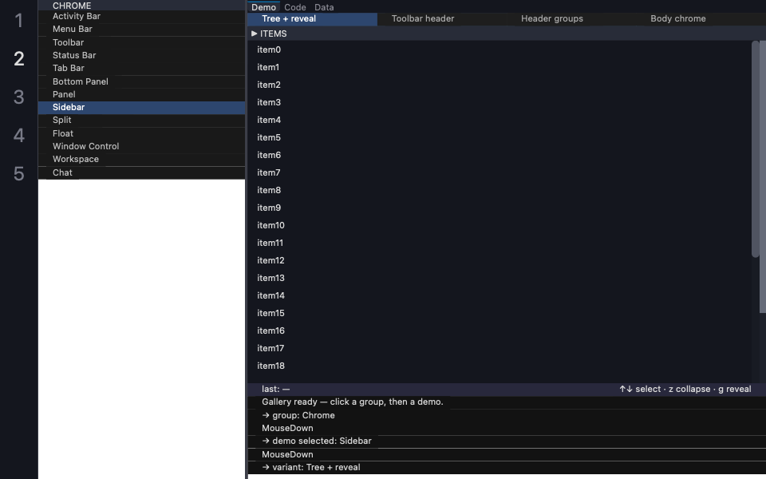

# quadraui

**One Rust UI codebase that runs in a terminal and as a native desktop window.**

quadraui is a widget toolkit with four rendering backends: **TUI** (via
ratatui), **GTK4** (Cairo + Pango), **macOS** (Core Graphics + Core Text)
and **Windows** (Direct2D + DirectWrite). You write your app once, and the
same code runs over SSH in a terminal or as a native window, with only
the one-line runner call in `main` changing.



*The quadraui gallery running as a native macOS window (Core Graphics).
The same widget code renders in a terminal and on the other native
backends — compare any demo across backends in the [Gallery](gallery/index.md).*

```rust
use quadraui::prelude::*;

struct Hello { keys_pressed: u32 }

impl Hello {
    fn config() -> ShellConfig {
        ShellConfig::new("Hello", Vec::new())
            .with_status_bar()
            // No panels, so no activity-bar column to pick one with.
            .with_activity_bar_width(0.0)
    }
}

impl ShellApp for Hello {
    fn render_content(&self, backend: &mut dyn Backend, layout: &AppShellLayout) {
        // The shell already computed where the status bar goes —
        // no viewport arithmetic here. Describe the UI as plain data;
        // the backend rasterises it natively.
        let Some(rect) = layout.status_bar_bounds else { return };
        let bar = StatusBar {
            id: WidgetId::new("status:bar"),
            left_segments: vec![StatusBarSegment {
                text: format!(" Hello, quadraui! (keys: {}) ", self.keys_pressed),
                fg: Color::rgb(255, 255, 255),
                bg: Color::rgb(40, 80, 120),
                bold: true,
                action_id: None,
            }],
            right_segments: vec![],
        };
        let mut frame = ScreenLayout::new();
        frame.push(Surface::StatusBar { rect, bar, hovered: None, pressed: None });
        frame.draw(backend);
    }

    fn handle(&mut self, event: UiEvent, _backend: &mut dyn Backend, _ctx: &ShellContext) -> Reaction {
        match event {
            UiEvent::KeyPressed { key: Key::Char('q'), .. } => Reaction::Exit,
            UiEvent::KeyPressed { .. } => { self.keys_pressed += 1; Reaction::Redraw }
            _ => Reaction::Continue,
        }
    }
}

fn main() {
    quadraui::tui::shell_runner::run_with_shell(Hello { keys_pressed: 0 }, Hello::config());
    // quadraui::gtk::shell_runner::run_with_shell(...), quadraui::macos::... or
    // quadraui::win::... for a native window: same `Hello`.
}
```

The full version is `quadraui/examples/hello.rs`:
`cargo run -p quadraui --example hello --features tui`.

## Why it is different

- **Terminal and native from one codebase.** Ratatui and Textual have no
  native backend; egui, iced and Slint have no terminal backend. quadraui
  has both, behind one trait.
- **Paint and click share one layout.** Every primitive exposes a
  `layout(...)` that the rasteriser paints from and the host hit-tests
  against. Mouse clicks cannot drift from what is on screen, because both
  read the same computed rectangles.
- **Small, and idle when idle.** The runtime is event-driven: an app with
  nothing to do renders nothing.
- **Declarative, serialisable widgets.** Primitives are plain data
  (`Serialize`), events are plain data routed by `WidgetId`, and no
  closures cross the API. That is what makes scripting practical (vimcode
  lets Lua extensions declare quadraui views), and later, language
  bindings.
- **Honest about capabilities.** `BackendCaps` tells an app what the
  current backend can do. Where a terminal cannot do something (a tray
  icon, a native dialog) the backend degrades and says so, rather than
  silently doing nothing.
- **Heavily tested.** Headless paint-then-click round trips on every
  backend, and an end-to-end driver that drives real example apps through
  the actual event loop — see the [Gallery](gallery/index.md) for every
  primitive this produces, captured straight from that same harness.

Browse the [Gallery](gallery/index.md) for a demo of every primitive —
captured live on the TUI and macOS backends today, with the GTK and
Windows columns in progress — or jump to
[Getting Started](getting-started.md) to add quadraui to your own project.
