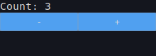
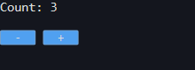
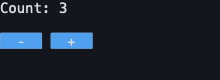

# quadraui

**A cross-platform UI framework for Rust, Python and Node.js that also runs in a terminal.**

Write an app once. It runs in a terminal (over SSH too) and as a native
window on macOS, Linux (GTK4) and Windows, drawn by quadraui's own renderers
for each.

| Terminal | GTK4 (Linux) | Windows | macOS |
|:---:|:---:|:---:|:---:|
|  |  |  |  |

*The counter below, as each backend paints it: real renders, made by
`scripts/capture_hero.sh` through each backend's headless test driver.*

If you know **Elm, iced, Textual or React**, you know the shape already:
**state**, a **view** that turns state into a widget tree each frame, and
**update** code that changes state when an event arrives. There is no data
binding and no manual redraw. [The shape of an app](concepts/index.md) maps
each part onto the framework you know. All three languages build the view
from the same `Column` and `Row` tree.

## The same counter, three ways

**Python**

<!-- sample: examples/hero/python/counter.py -->
```python
from quadraui.app import App, Button, Column, Row, Text


class Counter:
    def __init__(self):
        self.count = 0

    def view(self):
        return Column(
            Text(f"Count: {self.count}", id="count"),
            Row(
                Button("-", id="dec", on_click=self.dec),
                Button("+", id="inc", on_click=self.inc),
                size="content",
            ),
        )

    def inc(self):
        self.count += 1

    def dec(self):
        self.count -= 1


if __name__ == "__main__":
    App(view=Counter().view).run_tui()  # q quits; or .run_native(title="Counter"): same Counter
```

**TypeScript (JSX)**

<!-- sample: examples/hero/node/counter.tsx -->
```tsx
import { App } from "@quadraui/node/app";

class Counter {
  count = 0;

  view() {
    return (
      <column>
        <text id="count">Count: {this.count}</text>
        <row size="content">
          <button id="dec" label="-" onClick={() => this.count--} />
          <button id="inc" label="+" onClick={() => this.count++} />
        </row>
      </column>
    );
  }
}

if (require.main === module) {
  const counter = new Counter();
  new App({ view: () => counter.view() }).runTui(); // q quits; or .runNative("Counter"): same Counter
}
module.exports = { Counter };
```

**Rust**: the same tree. A node maps its events to a message, and one
`update` applies it, as in Elm and iced.

<!-- sample: examples/hero/rust/src/main.rs -->
```rust,noplayground
use quadraui::prelude::*;

#[derive(Default)]
pub struct Counter {
    pub count: i32,
}

#[derive(Clone)]
pub enum Msg {
    Inc,
    Dec,
}

impl View for Counter {
    type Msg = Msg;
    fn view(&self) -> Node<Msg> {
        column([
            text(format!("Count: {}", self.count)).id("count"),
            row([
                button("-").id("dec").on_click(Msg::Dec),
                button("+").id("inc").on_click(Msg::Inc),
            ])
            .content(),
        ])
    }
    fn update(&mut self, msg: Msg) -> Command {
        match msg {
            Msg::Inc => self.count += 1,
            Msg::Dec => self.count -= 1,
        }
        Command::None
    }
}

fn main() -> Result<(), quadraui::RunError> {
    run_tui(Counter::default()) // or run_native: the same Counter in a window
}
```

CI runs all three headless with the same clicks and checks the frame
(`examples/hero/`). [Bindings](bindings.md) lines them up part by part.

## Install

```sh
cargo add quadraui --features tui   # add gtk, macos or win for a native window
pip install quadraui
npm install @quadraui/node
```

Then pick a quick start, each about five minutes to a running terminal app
and a native window: [Rust](quick-start/rust.md),
[Python](quick-start/python.md), [Node and TypeScript](quick-start/node.md).

## Why quadraui

- **Terminal and native from one codebase.** Ratatui and Textual have no
  native backend; egui, iced and Slint have no terminal backend. quadraui
  has both, behind one trait.
- **The same model in three languages.** Python and Node use the same Rust
  renderer and the same widgets; only the syntax differs.
- **Paint and click share one layout.** A widget's layout is what it paints
  from and what its event handler hit-tests against, so clicks cannot drift
  from what is on screen.
- **Small, and idle when idle.** An app with nothing to do renders nothing.
- **Tested like an app, headless.** Every backend has a test driver that
  paints off screen and clicks what was painted. The screenshots in the
  [Widget gallery](gallery/index.md) come from those same drivers.

## Not a fit, today

No assistive-technology support yet, no IME (CJK) input, no right-to-left
text, and one window per app. The
[README](https://github.com/JDonaghy/quadraui#who-it-is-for) has the
details and the tracking issues.
