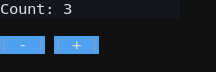

# quadraui

**A cross-platform UI framework for Rust, Python and Node.js that also runs in a terminal.**

Write an app once. It runs in a terminal (over SSH too) and as a native
window on macOS, Linux (GTK4) and Windows, drawn by quadraui's own renderers
for each.

| Terminal | GTK4 (Linux) | Windows | macOS |
|:---:|:---:|:---:|:---:|
|  |  |  |  |

*The counter below, as each backend paints it: real renders, made by
`scripts/capture_hero.sh` through each backend's headless test driver.*

If you know **Elm, iced, Textual or React**, you know the shape already:
**state**, a **view** that turns state into a widget tree each frame, and
**update** code that changes state when an event arrives. There is no data
binding and no manual redraw. [The shape of an app](concepts/index.md) maps
each part onto the framework you know. Python and Node build the view from
`Column` and `Row`; Rust, for now, implements a lower-level trait and
places each widget itself (third below).

## The same counter, three ways

**Python**

<!-- sample: examples/hero/python/counter.py -->
```python
from quadraui.app import App, Button, Column, Row, TextDisplay, key_name


def text(s):
    return [{"spans": [{"text": s, "fg": None, "bg": None}]}]


class Counter:
    def __init__(self):
        self.count = 0

    def view(self):
        return Column(
            TextDisplay(text(f"Count: {self.count}"), id="count"),
            Row(Button("-", id="dec", on_click=self.dec), Button("+", id="inc", on_click=self.inc)),
        )

    def inc(self):
        self.count += 1

    def dec(self):
        self.count -= 1

    def on_key(self, event):
        if key_name(event) == "q":
            raise SystemExit


if __name__ == "__main__":
    counter = Counter()
    App(30, 5, view=counter.view, on_event=counter.on_key).run_tui()  # or .run_native(title="Counter"): same Counter
```

**TypeScript (JSX)**

<!-- sample: examples/hero/node/counter.tsx -->
```tsx
import { App, keyName } from "@quadraui/node/app";

class Counter {
  count = 0;

  view() {
    return (
      <column>
        <textDisplay id="count" lines={[{ spans: [{ text: `Count: ${this.count}`, fg: null, bg: null }] }]} />
        <row>
          <button id="dec" label="-" onClick={() => this.count--} />
          <button id="inc" label="+" onClick={() => this.count++} />
        </row>
      </column>
    );
  }

  onKey(event: unknown, quit: () => void) {
    if (keyName(event) === "q") quit();
  }
}

if (require.main === module) {
  const counter = new Counter();
  const app = new App(30, 5, { view: () => counter.view(), onEvent: (e: unknown) => counter.onKey(e, quit) });
  const live = app.runTui(); // or app.runNative("Counter"): same Counter
  // No App.quit() yet: a key handler calls quit(), which stops the loop and the session once it returns.
  const quit = () => setImmediate(() => (live.stop(), app.stopLive()));
}
module.exports = { Counter };
```

**Rust**: the same three parts on the lower-level `AppLogic` trait. Rust has
no declarative `Column`/`Row` yet, so this view places widgets by hand.

<!-- sample: examples/hero/rust/src/main.rs -->
```rust,noplayground
use quadraui::prelude::*;
use quadraui::{primitive::DynWidget, Button, FrameTree, StyledSpan};
use std::cell::Cell;

#[derive(Default)]
pub struct Counter {
    pub count: i32,
    cell: Cell<(f32, f32)>,
}

impl Counter {
    fn view(&self) -> ScreenLayout {
        let (w, h) = self.cell.get(); // one character cell, in this backend's units
        let text = StyledSpan::plain(format!("Count: {}", self.count));
        let mut label = TextDisplay::new(WidgetId::new("count"));
        label.lines = vec![TextDisplayLine {
            spans: vec![text],
            decoration: Default::default(),
            timestamp: None,
        }];
        let mut ui = ScreenLayout::new();
        let mut put = |col: f32, row: f32, cols: f32, widget: Box<dyn DynWidget>| {
            let rect = Rect::new(col * w, row * h, cols * w, h);
            ui.push(Surface::Widget { rect, widget })
        };
        put(0.0, 0.0, 20.0, Box::new(label));
        put(0.0, 2.0, 5.0, Box::new(Button::new("dec".into(), "-")));
        put(6.0, 2.0, 5.0, Box::new(Button::new("inc".into(), "+")));
        ui
    }
}

impl AppLogic for Counter {
    type AreaId = ();
    fn render(&self, backend: &mut dyn Backend, _: ()) {
        self.cell.set((backend.char_width(), backend.line_height()));
        self.view().draw(backend);
    }
    fn frame_tree(&self, _: ()) -> FrameTree {
        self.view().into_frame_tree()
    }
    fn handle(&mut self, event: UiEvent, _: &mut dyn Backend) -> Reaction {
        match event {
            UiEvent::ButtonActivated { widget } if widget.as_str() == "inc" => self.count += 1,
            UiEvent::ButtonActivated { widget } if widget.as_str() == "dec" => self.count -= 1,
            UiEvent::KeyPressed {
                key: Key::Char('q'),
                ..
            } => return Reaction::Exit,
            _ => return Reaction::Continue,
        }
        Reaction::Redraw
    }
}

fn main() -> Result<(), quadraui::RunError> {
    quadraui::tui::run(Counter::default()) // or gtk::run, macos::run, win::run: same Counter
}
```

CI runs all three headless with the same clicks and checks the frame
(`examples/hero/`). [Bindings](bindings.md) lines them up part by part.

## Install

```sh
cargo add quadraui --features tui   # add gtk, macos or win for a native window
pip install quadraui
npm install @quadraui/node
```

Then pick a quick start, each about five minutes to a running terminal app
and a native window: [Rust](quick-start/rust.md),
[Python](quick-start/python.md), [Node and TypeScript](quick-start/node.md).

## Why quadraui

- **Terminal and native from one codebase.** Ratatui and Textual have no
  native backend; egui, iced and Slint have no terminal backend. quadraui
  has both, behind one trait.
- **The same model in three languages.** Python and Node use the same Rust
  renderer and the same widgets; only the syntax differs.
- **Paint and click share one layout.** A widget's layout is what it paints
  from and what its event handler hit-tests against, so clicks cannot drift
  from what is on screen.
- **Small, and idle when idle.** An app with nothing to do renders nothing.
- **Tested like an app, headless.** Every backend has a test driver that
  paints off screen and clicks what was painted. The screenshots in the
  [Widget gallery](gallery/index.md) come from those same drivers.

## Not a fit, today

No assistive-technology support yet, no IME (CJK) input, no right-to-left
text, and one window per app. The
[README](https://github.com/JDonaghy/quadraui#who-it-is-for) has the
details and the tracking issues.
